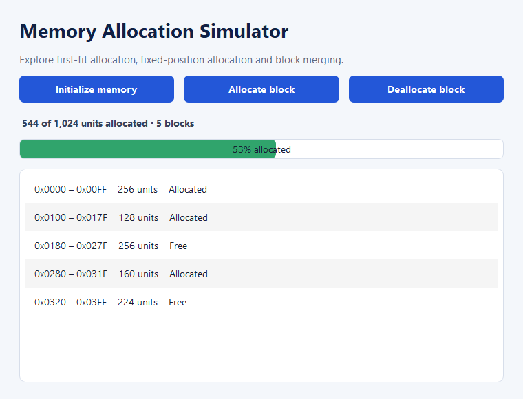

# Memory Allocation and Deallocation Simulator

A desktop visualization of contiguous memory management built with Python and PyQt5. The simulator demonstrates first-fit allocation, position-based allocation, deallocation and automatic merging of adjacent free blocks.

## Features

- Initialize a configurable memory space
- Allocate a block with first-fit selection
- Allocate at a specific valid address
- Deallocate by start address
- Merge adjacent free blocks automatically
- View allocation percentage and an address-based block map
- Validate invalid sizes, positions and deallocation requests

## Preview



## Project structure

```text
.
├── app.py                         PyQt5 desktop interface
├── memory_manager.py              Allocation model
├── tests/test_memory_manager.py   Unit tests
└── requirements.txt               Runtime dependency
```

## Setup

Requires Python 3.10 or newer.

```bash
python -m venv .venv
```

Activate the environment, then install the dependency:

```bash
python -m pip install -r requirements.txt
```

## Run

```bash
python app.py
```

## Test

```bash
python -m unittest discover -s tests -v
```

## How allocation works

The model stores memory as an ordered list of allocated and free blocks. First-fit scans from the lowest address and selects the first free block large enough for the request. Position-based allocation validates the complete address range before splitting a free block. Deallocation marks the selected block free and combines adjacent free ranges.

## Contributors

- Ahsan Chohan
- Umer Farooq
- Arshman Aizid

Developed as an academic operating-systems project.
